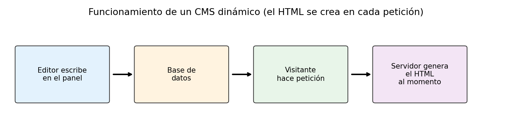
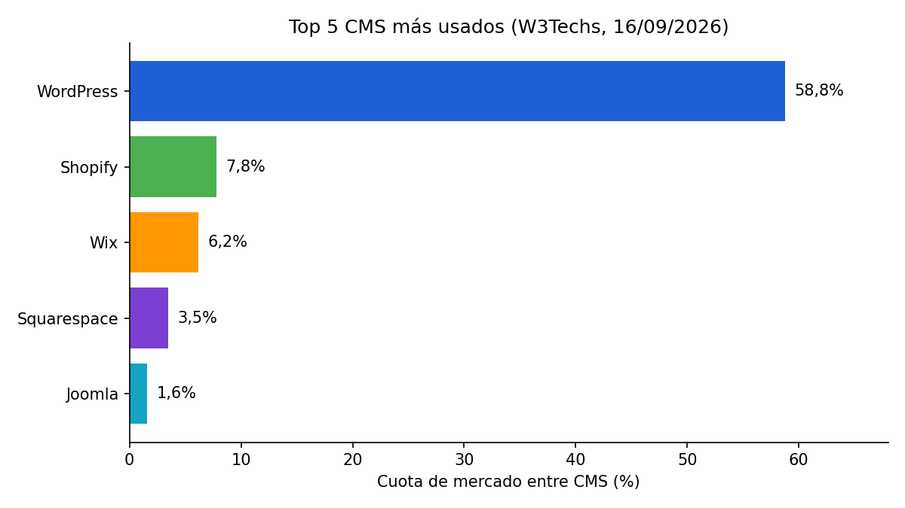

# Gestores de contenido (CMS)

> **Autor:** Jacinto Rodríguez  
> **Actividad:** CMS, SSG y Markdown

---

## Índice

1. [¿Qué es un CMS?](#qué-es-un-cms)
2. [¿Cómo funciona?](#cómo-funciona)
3. [Ventajas e inconvenientes](#ventajas-e-inconvenientes)
4. [Tipos de CMS y ejemplos](#tipos-de-cms-y-ejemplos)
5. [Los CMS más usados](#los-cms-más-usados)
6. [CMS dinámico frente a SSG](#cms-dinámico-frente-a-ssg)
7. [Vídeo explicativo](#vídeo-explicativo)

---

## ¿Qué es un CMS?

**CMS** significa *Content Management System*, es decir, ***Sistema de Gestión de Contenidos***.

Es un software que permite **crear, modificar, organizar y publicar** contenido en una web mediante una *interfaz de administración*, sin necesidad de escribir el código HTML directamente.

### ¿Para qué sirve?

Sirve para administrar una web y su contenido de una manera más sencilla: el CMS se encarga de gestionar todo ese contenido por nosotros.

## ¿Cómo funciona?

Los contenidos son lo que queremos mostrar a los visitantes. El proceso habitual es:

1. Escribimos el **título** y el **texto**.
2. Añadimos una imagen.
3. Pulsamos el botón `Publicar`.
4. El CMS:
   - guarda la información en una **base de datos**,
   - y la muestra en la web cuando alguien la visita.

Además de crearlos, desde el panel también se pueden:

- Modificar
- Organizar
- Publicar
- Eliminar



De forma muy simplificada, lo que hace un CMS como WordPress cuando llega una visita se parece a esto (pseudocódigo en PHP):

```php
<?php
// El HTML se genera en el momento de la petición
$entrada = $db->query("SELECT titulo, texto FROM entradas WHERE id = 1");
echo "<h1>" . $entrada['titulo'] . "</h1>";
echo "<p>" . $entrada['texto'] . "</p>";
?>
```

## Ventajas e inconvenientes

### Ventajas

- **Velocidad** de desarrollo y mantenimiento.
- Muchos son de **código abierto**.
- Funcionalidades avanzadas: formularios, mapas, calendario de eventos, etc.
- Fáciles de usar para personas con poca o ninguna habilidad técnica.
- Reducen costes: cuando los usuarios aprenden a usarlo, se desenvuelven solos y se necesita menos asistencia técnica.
- Disponen de una gran comunidad, que les da *robustez* y *fiabilidad*.

### Inconvenientes

- **Costes de implementación** para adaptarlo a las necesidades del usuario (plugins, temas, etc.).
- Consumo de **recursos del servidor**, que en casos extremos puede provocar su caída.
- Si los usuarios no aprenden los conceptos básicos del CMS, su uso no es eficiente y puede hacer falta contratar ayuda técnica.
- **Mantenimiento:** si no se actualiza periódicamente, pueden aparecer graves vulnerabilidades de seguridad.
- **Soporte técnico:** en plataformas mantenidas por la comunidad hay que confiar en foros y documentación.


## Tipos de CMS y ejemplos

Los CMS se clasifican según su **propósito**, su **licencia** y su **arquitectura**.

### Según su propósito

| Propósito | Descripción | Ejemplos |
| :-------- | :---------- | :------- |
| General | Priorizan la facilidad para publicar texto, imágenes y vídeo | WordPress, Joomla, Drupal |
| Comercio electrónico | Tiendas online con pasarela de pago, inventario, envíos y carrito | Shopify, PrestaShop, Magento/Adobe Commerce |
| Educación | Cursos online, alumnos, calificaciones y material | Moodle |
| Foros y comunidades | Hilos de discusión, perfiles, reputación y moderación | Discourse, phpBB |

### Según su arquitectura

#### Monolítico (tradicional o acoplado)

Une el *backend* y el *frontend* en un solo sistema. Ejemplos: **WordPress**, **Joomla**, **Drupal**.

#### Desacoplado

Separa el *backend* del *frontend*, pero incluye una capa de presentación predeterminada. Ejemplos: **Magnolia**, **Drupal desacoplado** (por ejemplo, con Acquia).

#### Headless

Elimina por completo la capa visual: solo almacena la información de forma estructurada y la distribuye mediante **APIs** a cualquier dispositivo. Ejemplos: **Strapi**, **Sanity**, **Contentful**.

##### Resumen de arquitecturas

- [x] Monolítico → backend + frontend juntos
- [x] Desacoplado → separados, con frontend incluido
- [x] Headless → solo backend + API


## Los CMS más usados

Según **W3Techs**[^1], con datos consultados el 27 de octubre de 2026, el top 5 de CMS a nivel mundial es:

| Puesto | CMS | % sobre todas las webs | % sobre webs con CMS conocido |
| :----: | :-- | ----: | ----: |
| 1 | WordPress | 39,6 % | 58,3 % |
| 2 | Shopify | 5,3 % | 7,9 % |
| 3 | Wix | 4,2 % | 6,2 % |
| 4 | Squarespace | 2,4 % | 3,6 % |
| 5 | Joomla | 1,1 % | 1,6 % |

**¿Qué mide cada columna?**

- **% sobre todas las webs:** de cada 100 sitios web analizados, cuántos usan ese CMS. Incluye las webs que no usan ningún CMS detectable (un 32,1 %).
- **% sobre webs con CMS conocido:** de cada 100 sitios que sí usan un CMS identificado, cuántos usan ese CMS. Es la «cuota de mercado» que suele citarse.

> **Conclusión:** WordPress domina con mucha diferencia: lo usan casi 4 de cada 10 webs del mundo y casi 6 de cada 10 que usan un CMS. Le siguen los CMS alojados (Shopify, Wix y Squarespace), lo que muestra que muchos usuarios prefieren servicios que incluyen el *hosting* y el mantenimiento.



## CMS dinámico frente a SSG

La gran diferencia es **cuándo se genera el HTML**: en un SSG ya está creado antes de recibir las visitas; en un CMS dinámico se genera cuando llega la petición.

| Aspecto | CMS dinámico | Generador estático |
| :-- | :-- | :-- |
| **Forma de crear contenidos** | Desde un panel web: se escribe el título y el texto, se añaden imágenes y se pulsa «Publicar» | Escribiendo archivos de texto (normalmente Markdown) que se combinan con plantillas |
| **Base de datos** | Sí, el contenido se guarda en una base de datos (por ejemplo, MySQL) | No, el contenido está en archivos |
| **Generación del HTML** | En el momento de la petición, cada vez que alguien visita la página | Antes de las visitas, durante el proceso de *build* |
| **Servidor necesario** | Servidor que ejecute el CMS (por ejemplo, PHP) y la base de datos | Solo un servidor o *hosting* que entregue archivos estáticos |
| **Panel de administración** | Sí, viene incluido | No de serie; se trabaja con archivos y un editor de código |
| **Conocimientos técnicos** | Bajos; pensado para usuarios sin experiencia técnica | Medios: Markdown, terminal, plantillas y Git |
| **Seguridad** | Más expuesto (base de datos, plugins, panel de acceso); necesita actualizaciones frecuentes | Menos superficie de ataque, porque no hay base de datos ni código ejecutándose en el servidor |
| **Rendimiento** | Depende del servidor, ya que cada visita genera la página (mejora con caché) | Muy alto, porque se entregan archivos ya creados |
| **Actualización del contenido** | Inmediata desde el panel | Hay que editar el archivo, volver a generar el sitio y publicarlo |
| **Publicación** | Instalando el CMS en un *hosting* con PHP y base de datos | Subiendo los archivos generados a un *hosting* estático (GitHub Pages, Netlify…) |
| **Ejemplos** | WordPress, Joomla, Drupal | Jekyll, Hugo, Astro |

Puedes ver la explicación completa de los generadores de sitios estáticos en el documento [ssg.md](ssg.md).

## Vídeo explicativo

Vídeo de menos de 5 minutos: [Qué es un CMS y para qué sirve (Explicado en 2 minutos)](https://www.youtube.com/watch?v=sSh5AAmItN0)

[](https://www.youtube.com/watch?v=sSh5AAmItN0)

---
