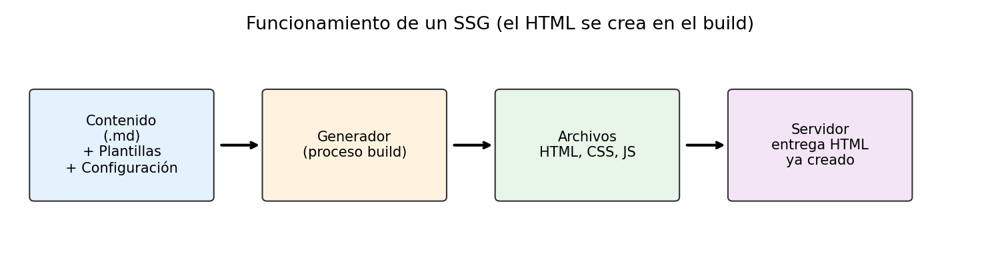

# Generadores de sitios estáticos (SSG)

> **Autor:** Jacinto Rodríguez  
> **Actividad:** CMS, SSG y Markdown

← [Volver a cms.md](cms.md)

---

## Índice

1. [¿Qué es un SSG?](#qué-es-un-ssg)
2. [Archivos de partida](#archivos-de-partida)
3. [¿Cómo funciona?](#cómo-funciona)
4. [Ventajas e inconvenientes](#ventajas-e-inconvenientes)
5. [Comparativa: Jekyll, Hugo y Astro](#comparativa-jekyll-hugo-y-astro)
6. [Vídeo explicativo](#vídeo-explicativo)

---

## ¿Qué es un SSG?

Un **generador de sitios estáticos** o ***SSG*** (*Static Site Generator*) es una herramienta que automatiza la creación de sitios web a partir de archivos de contenido, plantillas y archivos de configuración, y crea los archivos HTML por nosotros.

> En resumen: nosotros preparamos el contenido y las plantillas, y el SSG genera las páginas HTML finales.

### ¿Para qué sirve?

Facilita la administración de una web y su contenido. Solo tenemos que cambiar el **contenido**, ya que la plantilla mantiene un diseño uniforme y el SSG se encarga de aplicar los cambios a toda la web.

## Archivos de partida

Para usar un SSG necesitamos tres cosas diferenciadas:

1. **Contenido**
   - Normalmente en Markdown (`.md`), un formato de texto que permite escribir sin preocuparse de las etiquetas HTML.
2. **Plantillas**
   - Definen la estructura de la página. Son como un *molde*: siempre la misma estructura, pero con distinto contenido.
3. **Configuración**
   - Datos generales del sitio: título, idioma, URL, etc.

> 💡 Si tuviésemos **500 archivos HTML** escritos a mano y quisiéramos cambiar el pie de página, tendríamos que editar los 500. Con una plantilla, se cambia **en un solo sitio**.

Ejemplo de archivo de contenido en Markdown con su cabecera de configuración (*front matter*):

```markdown
---
title: "Mi primera entrada"
date: 2026-10-05
layout: post
---

# Hola mundo

Este es el contenido de **mi entrada**.
```

## ¿Cómo funciona?

El generador lee el contenido y las plantillas, los **combina** y crea los archivos que el navegador puede interpretar.



### ¿En qué momento se genera el HTML?

El HTML se genera **previamente**, durante el proceso de *build*. Cuando el usuario visita la página, el servidor solo entrega el archivo HTML que ya estaba creado.

## Ventajas e inconvenientes

Frente a crear y mantener una web directamente con HTML:

| ✅ Ventajas | ❌ Inconvenientes |
| :---------- | :---------------- |
| Fácil mantenimiento de sitios con muchas páginas | Complejidad innecesaria para sitios pequeños |
| Separa contenido y diseño | Cada cambio exige volver a generar el sitio |
| Reutiliza componentes y automatiza tareas | Las funciones dinámicas requieren tecnologías adicionales |
| Compatible con control de versiones (Git) | Requiere conocimientos técnicos básicos |
| Muy rápido y menos expuesto a ataques | |

## Comparativa: Jekyll, Hugo y Astro

| Aspecto | Jekyll | Hugo | Astro |
| :------ | :----: | :--: | :---: |
| Lenguaje principal | Ruby | Go | JavaScript / TypeScript (Node.js) |
| Formato del contenido | Markdown + HTML | Markdown + HTML/plantillas | `.astro`, Markdown/MDX + HTML |
| Instalación | Ruby + Jekyll y dependencias | Un único ejecutable (p. ej., con `winget`) | Proyecto Node.js (npm) |
| Funcionamiento básico | Contenido + plantilla → HTML | Contenido + plantilla → HTML | Contenido + plantilla → HTML; admite renderizado bajo demanda |
| Usos habituales | Blogs, documentación | Blogs, documentación, sitios grandes | Blogs, portfolios, documentación, webs modernas |
| Ventajas | Maduro y sencillo | Generación muy rápida, ejecutable independiente | Flexible, componentes e integraciones modernas |
| Inconvenientes | Depende de tener Ruby instalado | Sistema de plantillas propio que hay que aprender | Más conceptos de JavaScript |
| ¿GitHub Pages? | Sí | Sí | Sí |

### Conclusiones

- **Jekyll**: buena opción si se quiere algo *clásico* y con integración directa en GitHub Pages.
- **Hugo**: ideal cuando la **velocidad** de generación es importante o el sitio es muy grande.
- **Astro**: la más *moderna*; recomendable si ya se conoce JavaScript.

#### Lista de tareas de la práctica

- [x] Investigar qué es un SSG
- [x] Comparar Jekyll, Hugo y Astro

## Vídeo explicativo

Vídeo de menos de 5 minutos: [Hugo in 100 Seconds](https://www.youtube.com/watch?v=0RKpf3rK57I)

[](https://www.youtube.com/watch?v=0RKpf3rK57I)

---
