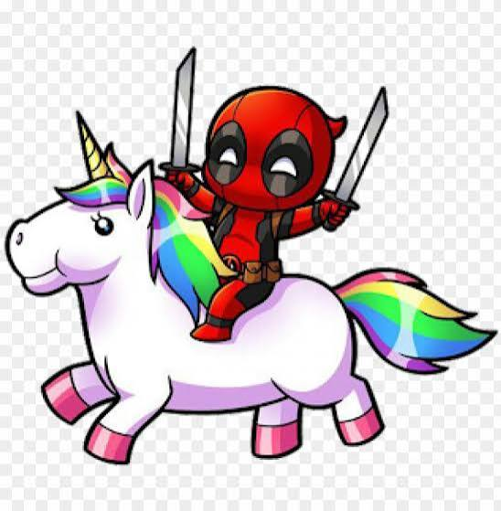

# ¿Qué es Markdown?

## ¿Qué es Markdown?

### ¿Qué es Markdown?

**Sintaxis básica**

*Sintaxis básica*

>Sintaxis básica

1. First item
2. Second item

- First item
- Second item

`
{console.log("Hola Mundo!")}
`

- [X] Realiza la subida

[titulo](https://www.google.com/maps/@40.4270698,-3.631923,15z?entry=ttu&g_ep=EgoyMDI2MDkyNy4xIKXMDSoASAFQAw%3D%3D)

| Tabla | Concepto |
| ---- | ---- |
| header | Text |
| Pragraph  | | Text |

Pinto una linea
---